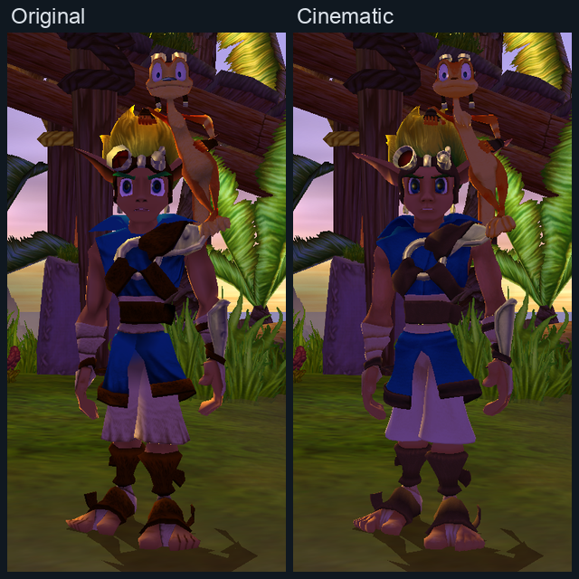
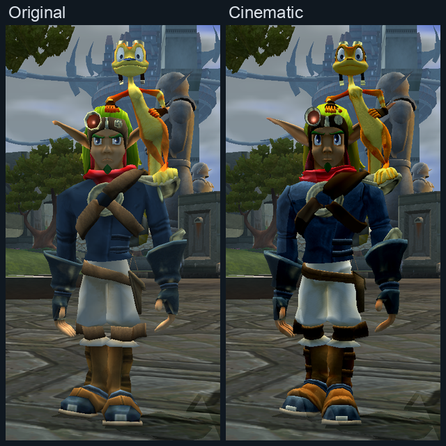
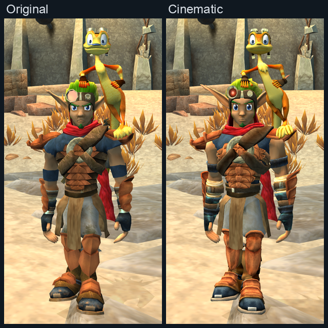

# The Cinematic Legacy

Play the Jak and Daxter trilogy with Naughty Dog’s cinematic character models during normal gameplay.

[Jak and Daxter](https://github.com/JacopoBassan/the-cinematic-legacy-jak1) · [Jak II](https://github.com/JacopoBassan/the-cinematic-legacy-jak2) · [Jak 3](https://github.com/JacopoBassan/the-cinematic-legacy-jak3)

<table width="100%">
<thead><tr><th width="33%">Jak and Daxter</th><th width="33%">Jak II</th><th width="33%">Jak 3</th></tr></thead>
<tbody><tr>
<td><a href="https://github.com/JacopoBassan/the-cinematic-legacy-jak1/blob/main/docs/comparisons/jak1.md"></a></td>
<td><a href="https://github.com/JacopoBassan/the-cinematic-legacy-jak2/blob/main/docs/comparisons/jak2.md"></a></td>
<td><a href="https://github.com/JacopoBassan/the-cinematic-legacy-jak3/blob/main/docs/comparisons/jak3.md"></a></td>
</tr></tbody>
</table>

[Behind the scenes](docs/behind-the-scenes.md)

## Why I made this

Jak and Daxter is probably my favorite trilogy of all time, and I spent countless hours playing these games when they first came out on PS2. I was already replaying them through PCSX2 when I found out about OpenGOAL, so you can imagine how happy I was.

Seeing the games in widescreen and at higher resolutions got me wondering what they would look like with the more detailed cutscene models during normal gameplay. I first asked about this on the OpenGOAL Discord [on 2 August 2024](https://discord.com/channels/756287461377703987/949828064026714174/1268810551509909575), and the replies explained why it wouldn’t be a simple swap: different skeletons, missing eye and facial animation, and a model importer that couldn’t bring over the facial blend shapes.

Two years later, I finally decided to have a go at making it work myself, and there turned out to be quite a bit more to it than swapping the models. I had to adapt them to the gameplay skeletons, fit their facial shapes to the games’ existing expression controls and rebuild the model data needed to make those deformations work. Eyes, jaw and brow movement, hands and clothing needed their own attention too.

For some characters, I combined cinematic models with gameplay parts or textures where I felt it better preserved their in-game appearance.

It took quite a bit of work, but here we are! These are Naughty Dog’s original models from the games, adapted for gameplay, and I hope you enjoy them as much as I do.

For Jak 1, the more detailed models come from Jak II, including Jak’s classic appearance from its opening cutscene.

I’ve put a lot of care into checking these models, though full playthroughs still need testing. If I’ve missed anything, just let me know and I’ll get it fixed! I might already be working on a few little touch-ups here and there.

[A look behind the scenes](docs/behind-the-scenes.md)

## Models and forms

✅ Included in the mod.

<table>
<thead><tr><th scope="col">Model / form</th><th scope="col">Jak 1</th><th scope="col">Jak II</th><th scope="col">Jak 3</th></tr></thead>
<tbody>
<tr><th scope="row">Jak</th><td>✅</td><td>✅</td><td>✅</td></tr>
<tr><th scope="row">Daxter</th><td>✅</td><td>✅</td><td>✅</td></tr>
<tr><th scope="row">Dark Jak</th><td>-</td><td>✅</td><td>✅</td></tr>
<tr><th scope="row">Light Jak</th><td>-</td><td>-</td><td>✅</td></tr>
<tr><th scope="row">Samos</th><td>✅</td><td>✅¹</td><td>-</td></tr>
<tr><th scope="row">Keira</th><td>✅</td><td>✅¹</td><td>-</td></tr>
<tr><th scope="row">Sig</th><td>-</td><td>✅</td><td>✅²</td></tr>
<tr><th scope="row">Ashelin</th><td>-</td><td>✅</td><td>✅</td></tr>
<tr><th scope="row">Damas (rider)</th><td>-</td><td>-</td><td>✅</td></tr>
<tr><th scope="row">Kleiver (rider)</th><td>-</td><td>-</td><td>✅</td></tr>
<tr><th scope="row">Jinx</th><td>-</td><td>-</td><td>✅</td></tr>
<tr><th scope="row">Crimson Guard</th><td>-</td><td>-</td><td>✅</td></tr>
<tr><th scope="row">Cyber Errol</th><td>-</td><td>-</td><td>✅</td></tr>
<tr><th scope="row">Air transport</th><td>-</td><td>-</td><td>✅</td></tr>
</tbody>
</table>

¹ Jak II: stadium Samos and Keira. Their other scenes already use cinematic models. ² Jak 3: Sig’s rider and convoy models.

## Install

<table>
<thead><tr><th scope="col">Platform</th><th scope="col">Launcher install</th><th scope="col">Gameplay checks</th></tr></thead>
<tbody>
<tr><th scope="row">Windows x64</th><td>✅ Tested</td><td>✅ Tested</td></tr>
<tr><th scope="row">macOS · Apple Silicon</th><td>✅ Tested</td><td>✅ Tested</td></tr>
<tr><th scope="row">Linux x64</th><td>🧪 Experimental</td><td>➖ Not tested</td></tr>
</tbody>
</table>

Gameplay checks cover selected scenes and animations. Linux launcher import, model conversion and gameplay are not yet validated.

Requires official OpenGOAL **v0.3.9** and a supported EU or USA game installation. Jak 1 also needs vanilla Jak II installed in the same launcher.

1. Install the vanilla game in [OpenGOAL Launcher](https://opengoal.dev), then close the game.
2. Open **Settings > Mods**, paste this source URL, and press **Add**:

   ```text
   https://raw.githubusercontent.com/JacopoBassan/the-cinematic-legacy/main/docs/mods.json
   ```

3. Return to the game and open **Features > Mods**. Select **The Cinematic Legacy** for that game.
4. Press **Install**, wait for setup, then press **Play**.

The installer builds the replacements from your installed game files. No game models or textures are included. Python is included.

**Saves:** Vanilla OpenGOAL saves are not imported automatically. You can copy your existing progress into the mod’s save folder and keep the original. [How to copy your saves](docs/copy-saves.md).

If you used **Add from File** before, keep that install until you have copied its saves to the source install. [Save copy guide](docs/copy-saves.md#from-an-earlier-local-install).

Manual downloads and game requirements: [Jak and Daxter](https://github.com/JacopoBassan/the-cinematic-legacy-jak1#install) · [Jak II](https://github.com/JacopoBassan/the-cinematic-legacy-jak2#install) · [Jak 3](https://github.com/JacopoBassan/the-cinematic-legacy-jak3#install).

## Development

Each game repository contains its own builder and release workflow. This hub holds the launcher list and shared guides. [Maintainer guide](CONTRIBUTING.md).

Made possible by [OpenGOAL](https://opengoal.dev) and based on [OG-Mod-Base](https://github.com/OpenGOAL-Mods/OG-Mod-Base). All character models are Naughty Dog’s original work. Source code and license notices are in the game repositories.

Developed by [@jacopobassan](https://jacopobassan.me)

<sub>Crafted with help from Codex</sub>
